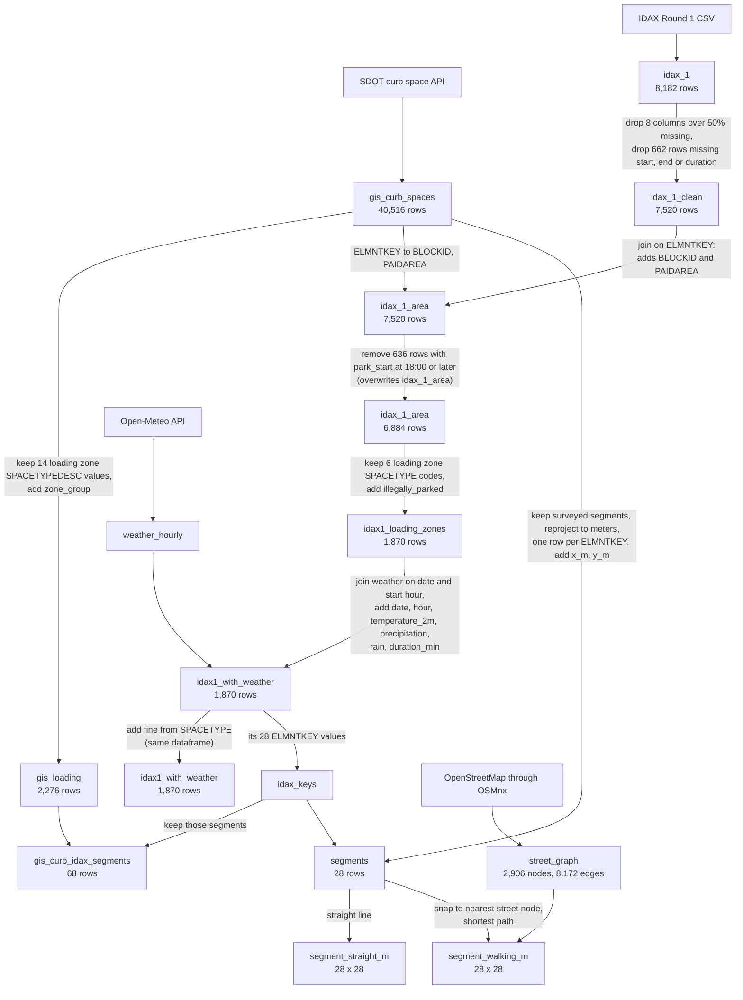

# EDA notebook: the data pipeline

Guide to `notebooks/01-eda.ipynb`. It tracks only the dataframes where the base data changes: cleaning, filtering, joining, and adding or removing rows or columns. Tables and charts made for a single analysis aren't listed. Row counts come from the notebook's saved outputs as of 2026-11-25. If you change the pipeline or rename things, update this file.

## Naming convention

- `gis_*` is data from SDOT's curb space inventory (ArcGIS API).
- `idax_*` and `idax1_*` is data from the IDAX observation survey (`idax_1` is round 1).

## Pipeline

`idax_1_area` appears twice because the notebook reuses the name: the join result (7,520 rows) is overwritten by the 6 PM filter (6,884 rows). Cells below the 6 PM cell see the filtered version.

`idax_2` and `idax_3` are loaded and compared against `idax_1`, then set aside. They are small and their columns don't line up with round 1.

## What changes at each step

| Dataframe | Built from | What changed | Rows |
|---|---|---|---|
| `gis_curb_spaces` | SDOT API | Loaded, paged 2,000 at a time | 40,516 |
| `gis_loading` | `gis_curb_spaces` | Filtered to 14 loading zone `SPACETYPEDESC` values (the `LOADING_GROUPS` dictionary), added `zone_group` (General load/unload 933, Passenger (PLZ) 833, Commercial/truck 464, Shared/hybrid 46) | 2,276 |
| `idax_1` | IDAX round 1 CSV | Loaded as is | 8,182 |
| `idax_1_clean` | `idax_1` | Replaced `<null>` text with missing values, dropped 8 columns over 50% missing, dropped rows missing start, end or duration | 7,520 |
| `idax_1_area` | `idax_1_clean` | Joined to `gis_curb_spaces` on `ELMNTKEY`, added `BLOCKID` and `PAIDAREA` | 7,520 |
| `idax_1_area` (same name) | `idax_1_area` | Removed arrivals at 6 PM or later | 6,884 |
| `idax1_loading_zones` | `idax_1_area` | Filtered to 6 loading zone `SPACETYPE` codes, added `illegally_parked` (`activity_type == 'Private'`: 1,066 True, 804 False) | 1,870 |
| `weather_hourly` | Open-Meteo API (Seattle, 2024-04-30 to 2024-06-13) | Loaded hourly `temperature_2m` and `precipitation`, added `date` and `hour` | one row per hour |
| `idax1_with_weather` | `idax1_loading_zones` | Added `date` (from `Date`) and `hour` (from `park_start`), joined to `weather_hourly` on both, added `temperature_2m`, `precipitation`, `rain` (precipitation above 0: 287 rain, 1,583 dry), `duration_min` (from `total_duration`) | 1,870 |
| `idax1_with_weather` (same name) | `idax1_with_weather` | Added `fine` in dollars from `SPACETYPE`: 78 for `CVLZ` (1,389 rows), `PS-CVLZ` (153) and `CVLZ/PS` (148); 63 for `L/UL` (112), `LOAD` (58) and `PS-VEN` (10) | 1,870 |
| `idax_keys` | `idax1_with_weather` | The 28 unique `ELMNTKEY` values (street segments) in the survey | 28 values |
| `gis_curb_idax_segments` | `gis_loading` | Filtered to the 28 surveyed `ELMNTKEY` values. Despite the name it holds only loading zones, not all curb space. The distances no longer use it | 68 |
| `segments` | `gis_curb_spaces` | Filtered to all curb space on the surveyed keys, reprojected to EPSG:32610 (meters), merged to one row per `ELMNTKEY` (the index), keeps `PAIDAREA`, `SIDE`, `BLOCKID`, added `x_m`, `y_m` (central point) | 28 |
| `street_graph` | OpenStreetMap through OSMnx | Walking network, downloaded once around the surveyed segments and loaded from `data/street_graph.graphml`. A network, not a dataframe | 2,906 nodes, 8,172 edges |
| `segment_straight_m` | `segments` | Straight-line distance in meters between every pair of central points | 28 x 28 |
| `segment_walking_m` | `segments`, `street_graph` | Walking distance in meters: each central point snapped to its nearest street node, then shortest path by `length` | 28 x 28 |

All the analysis cells below the weather join use `idax1_with_weather`. The `fine` column is added right after the join, in the "Adding fine data" section. Watch out for `gis_loading` versus `idax1_loading_zones`: `gis_loading` describes the zones (the curb itself), and `idax1_loading_zones` describes vehicles seen at them.

## Data problems we found

- **Missing values are the text `<null>`**, not real missing values. Convert with `.replace('<null>', pd.NA)` before counting or filtering.
- **`BLOCK_ID` 53 is wrong.** It is really curb block `07-22` (7th Ave between Blanchard and Bell, Denny Triangle). 604 raw rows have it (574 after cleaning). Join on `ELMNTKEY`, not `BLOCK_ID`. This is why `idax_1_area` joins on `ELMNTKEY`. Any cell that still groups by `BLOCK_ID` shows block 53 separately. Use `BLOCKID` instead.
- **Rows with a missing start, end or duration are removed in `idax_1_clean`** (662 of 8,182). The 662 are probably the longest stays (vehicles there before or after observers).
- **Survey covers weekdays only**, from 2024-04-30 to 2024-06-13 (23 days). There is no Saturday or Sunday data. In `idax1_loading_zones`: Thursday 537, Wednesday 509, Tuesday 393, Friday 290 and Monday 141 stays. Belltown has no Monday data at all, so any weekday-by-area chart has an empty Monday for Belltown.
- **The survey stops at about 7 PM.** Arrivals at 6 PM or later (636 rows) are removed in the cleaning section, because the cutoff cuts their durations short.
- **`park_start` and `park_end` are text.** `.min()` or sorting compares them character by character, so `10:00:00` comes before `7:00:00`. Convert with `pd.to_timedelta` first. The earliest arrival is just after 7:00.
- **`total_duration` is `park_end` minus `park_start`.** In an earlier check on a 2,056-row loading zone set, 2,054 rows matched to within a second.
- **Only 28 street segments are covered**, in Belltown and Denny Triangle. Of the 255 segments there with at least one loading zone in `gis_loading`, the survey covers 28 (11%): 17 of 176 in Belltown and 11 of 79 in Denny Triangle.
- **`ELMNTKEY` is the location unit.** Using all curb space, each surveyed key has one side and one block ID, and spans about 75 to 125 m. A parking event can't be tied to a specific curb space within a key. There are 28 keys but 18 `unitdesc` values, because some descriptions cover more than one key.
- **The span check and the one-key map use `gis_loading`**, so they measure only loading zones (spans up to about 100 m). The 75 to 125 m figure comes from all curb space.
- **IDAX and GIS space types don't fully match.** `idax1_with_weather` includes `CVLZ/PS` (148 events), `LOAD` (58) and `PS-VEN` (10), and these codes aren't among the loading zones in `gis_loading` on the surveyed segments. `gis_loading` also includes passenger load zones, which the survey filter leaves out. Join the two on `ELMNTKEY` only.
- **Some walking distances are shorter than straight-line distances** (16 of 378 pairs). This comes from moving each central point to its nearest street node. Two pairs (53433 and 53434, 76053 and 76054) are about 20 m apart but show 0 m walking. On average, walking is 769 m against 633 m in a straight line.
- **One cell still downloads the street network.** It calls `ox.graph_from_polygon`, and its last run timed out. The next cell loads the saved file, so the download cell can be skipped. The saved file isn't on Git.
- **Loading zone filter.** `idax1_loading_zones` keeps `SPACETYPE` codes `CVLZ`, `CVLZ/PS`, `PS-CVLZ`, `PS-VEN`, `L/UL` and `LOAD`. The comment above that cell still lists description names, so it doesn't match the codes.
- **No double-parking field exists.** The group defined an illegal stay as `activity_type == 'Private'` (`illegally_parked`). That is a proxy: it is any private-vehicle stay in a loading zone, not a confirmed violation.
- **Two ways to get duration.** `duration_min` in `idax1_with_weather` is the saved column. Two other cells, above the GIS section, rebuild `dur_min` and `start_hour` from scratch on copies (`loading_6pm_with_duration` and `d`), so they don't add to the pipeline.
- **`idax_1_area` is assigned three times.** An early join on `BLOCK_ID` (from `idax_1`, 8,182 rows), then the `ELMNTKEY` join (from `idax_1_clean`, 7,520 rows), then the 6 PM filter (6,884 rows). Rerunning a cell below the filter without rerunning from the top can filter twice or use an older version.
