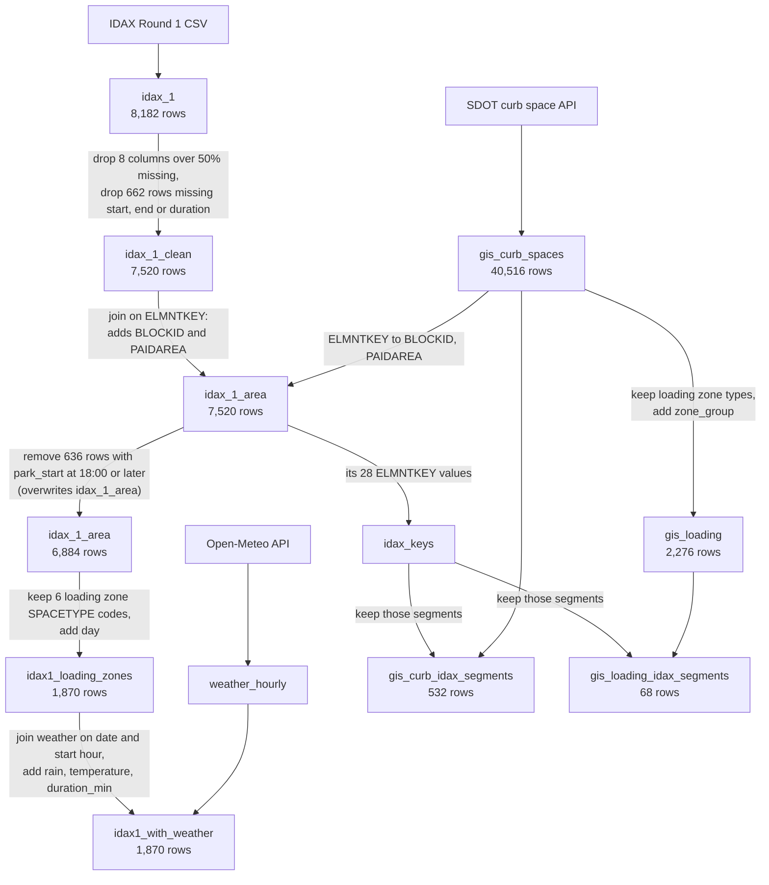

# EDA notebook: the data pipeline

Guide to `notebooks/01-eda.ipynb`. It tracks only the dataframes where the base data changes: cleaning, filtering, joining, and adding or removing rows or columns. Tables and charts made for a single analysis aren't listed. Row counts come from the notebook's saved outputs as of 2026-11-19. If you change the pipeline or rename things, update this file.

## Naming convention

- `gis_*` is data from SDOT's curb space inventory (ArcGIS API).
- `idax_*` and `idax1_*` is data from the IDAX observation survey (`idax_1` is round 1).

## Pipeline

`idax_1_area` appears twice because the notebook reuses the name: the join result (7,520 rows) is overwritten by the 6 PM filter (6,884 rows). Cells below the 6 PM cell see the filtered version.

`idax_2` and `idax_3` are loaded and compared against `idax_1`, then set aside. They are small and their columns don't line up with round 1.

## What changes at each step

| Dataframe | Built from | What changed | Rows |
|---|---|---|---|
| `gis_curb_spaces` | SDOT API | Loaded, paged 2,000 at a time | 40,516 |
| `gis_loading` | `gis_curb_spaces` | Filtered to loading zone types, added `zone_group` | 2,276 |
| `gis_curb_idax_segments` | `gis_curb_spaces` | Filtered to the 28 surveyed `ELMNTKEY` values | 532 |
| `gis_loading_idax_segments` | `gis_loading` | Filtered to the 28 surveyed `ELMNTKEY` values | 68 |
| `idax_1` | IDAX round 1 CSV | Loaded as is | 8,182 |
| `idax_1_clean` | `idax_1` | Replaced `<null>` text with missing values, dropped 8 columns over 50% missing, dropped rows missing start, end or duration | 7,520 |
| `idax_1_area` | `idax_1_clean` | Joined to `gis_curb_spaces` on `ELMNTKEY`, added `BLOCKID` and `PAIDAREA` | 7,520 |
| `idax_1_area` (same name) | `idax_1_area` | Removed arrivals at 6 PM or later | 6,884 |
| `idax1_loading_zones` | `idax_1_area` | Filtered to 6 loading zone `SPACETYPE` codes, added `day` | 1,870 |
| `weather_hourly` | Open-Meteo API | Loaded hourly temperature and rain | one row per hour |
| `idax1_with_weather` | `idax1_loading_zones` | Joined to `weather_hourly` on date and start hour, added `rain`, `temperature_2m`, `precipitation`, `duration_min` | 1,870 |

Watch out for `gis_loading` versus `idax1_loading_zones`. `gis_loading` describes the zones (the curb itself). `idax1_loading_zones` describes vehicles seen at them.

## Data problems we found

- **Missing values are the text `<null>`**, not real missing values. Convert with `.replace('<null>', pd.NA)` before counting or filtering.
- **`BLOCK_ID` 53 is wrong.** It is really curb block `07-22` (7th Ave between Blanchard and Bell, Denny Triangle). 604 raw rows have it (574 after cleaning). Join on `ELMNTKEY`, not `BLOCK_ID`. This is why `idax_1_area` joins on `ELMNTKEY`. Any cell that still groups by `BLOCK_ID` shows block 53 separately. Use `BLOCKID` instead.
- **Rows with a missing start, end or duration are removed in `idax_1_clean`** (662 of 8,182). The 662 are probably the longest stays (vehicles there before or after observers).
- **Survey covers weekdays only**, from 2024-04-30 to 2024-06-13 (23 days). There is no Saturday or Sunday data. In `idax1_loading_zones`: Thursday 537, Wednesday 509, Tuesday 393, Friday 290 and Monday 141 stays.
- **The survey stops at about 7 PM.** Arrivals at 6 PM or later (636 rows) are removed in the cleaning section, because the cutoff cuts their durations short. A stale markdown note further down still says this needs to be done. It already has been.
- **`total_duration` is `park_end` minus `park_start`.** In an earlier check on a 2,056-row loading zone set, 2,054 rows matched to within a second.
- **Only 28 street segments are covered**, in Belltown and Denny Triangle. Only 68 of the 2,276 loading zone records are on them (3%). See the limitations section of the notebook.
- **Loading zone filter.** `idax1_loading_zones` keeps `SPACETYPE` codes `CVLZ`, `CVLZ/PS`, `PS-CVLZ`, `PS-VEN`, `L/UL` and `LOAD`. The comment above that cell still lists description names, so it doesn't match the codes.
- **No double-parking field exists**, and the definition of an illegal stay isn't set yet.
- **The weather arrivals-per-hour cell uses hours 7 to 18**, but arrivals at hour 18 were removed in cleaning, so hour 18 adds empty rows. Use hours 7 to 17.
- **`idax_1_area` is assigned three times.** An early join on `BLOCK_ID` (from `idax_1`, 8,182 rows), then the `ELMNTKEY` join (from `idax_1_clean`, 7,520 rows), then the 6 PM filter (6,884 rows). Rerunning a cell below the filter without rerunning from the top can filter twice or use an older version.
